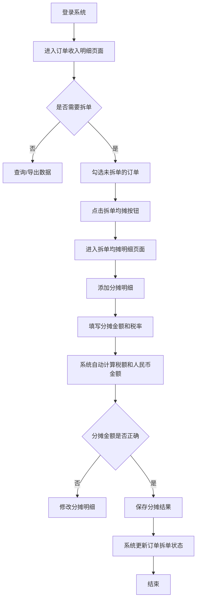

# 订单收入明细与拆单均摊功能V1.0-需求PRD

## 文档信息

| 项目 | 内容 |
|------|------|
| 项目名称 | 业财一体化系统 |
| 版本号 | V1.0 |
| 编写日期 | 2024-05-25 |
| 编写人 | 产品部 |

## 修改记录

| 版本号 | 修改日期 | 修改人 | 审核人 | 修改内容摘要 |
|--------|----------|--------|--------|--------------|
| V1.0 | 2024-05-25 | 产品部 | | 初始版本，包含订单收入明细和拆单均摊两个模块 |

---
## 1 需求背景
随着公司业务量的快速增长，现有财务核算系统存在以下痛点：
1. 订单收入数据分散在多个业务系统中，财务人员需要手动汇总核对，效率低下且容易出错
2. 同一业务参考编号下的订单往往涉及多个账单主体，财务人员需要手动拆分收入和成本，工作量大
3. 收入分摊缺乏系统化管理，分摊过程不透明，难以追溯审计
4. 缺少统一的订单收入明细查询入口，业务和财务人员获取数据困难
5. 拆单操作缺乏权限控制和校验机制，容易出现重复拆单或错误拆单的情况

## 2 需求目标及价值
### （一）调研信息和数据
- 财务部门每月处理拆单均摊业务超过500笔，每笔平均耗时20分钟，每月累计耗时超过160小时
- 手动拆单出错率约为8%，每月需要花费约40小时进行差错核对和修正
- 业务部门每月查询订单收入数据超过2000次，平均每次查询耗时15分钟

### （二）需求预期目标
**本次产品迭代的目标是实现以下功能和效果：**

| 序号 | 模块 | 价值 |
|------|------|--------|
| 1 | 订单收入明细查询 | 统一订单收入数据入口，查询效率提升80%，数据准确性达到100% |
| 2 | 拆单均摊管理 | 实现拆单操作系统化、自动化，拆单效率提升90%，出错率降低到1%以下 |
| 3 | 自定义字段配置 | 满足不同角色用户的数据查看需求，减少重复开发工作 |
| 4 | 数据统计分析 | 提供实时的收入、成本、毛利统计，为业务决策提供数据支持 |

## 3 需求概述
### （一）用户角色
| 角色 | 权限范围 |
|------|----------|
| 财务人员 | 订单收入明细查询、拆单均摊操作、数据导出、自定义字段配置 |
| 业务人员 | 订单收入明细查询（权限范围内）、数据导出 |
| 管理人员 | 订单收入明细全量查询、数据统计分析、拆单审核 |
| 系统管理员 | 字段配置、权限管理、日志查询 |

### （二）总体流程

### （三）功能摘要
**本产品主要包含以下核心功能：**

| 序号 | 模块 | 功能 | 描述 |
|------|------|--------|------|
| 1 | 订单收入明细 | 多条件查询 | 支持客户名称、仓库、业务模式、业务参考编号、是否结算、是否拆单、订单时间范围等多维度筛选 |
| 2 | 订单收入明细 | 数据统计 | 实时显示收入、成本、毛利的含税和不含税汇总金额，支持按选中行统计 |
| 3 | 订单收入明细 | 列表展示 | 展示订单全量字段，支持自定义列显示配置 |
| 4 | 订单收入明细 | 拆单均摊操作 | 支持勾选未拆单的订单进行拆单操作，已拆单的订单不可再次拆单 |
| 5 | 订单收入明细 | 自定义字段 | 支持用户根据需求配置列表显示字段 |
| 6 | 拆单均摊明细 | 数据查询 | 支持多条件查询已拆单的订单数据 |
| 7 | 拆单均摊明细 | 统计汇总 | 显示收入、成本、毛利的汇总统计 |
| 8 | 拆单均摊明细 | 分摊管理 | 支持新增、删除分摊明细，自动计算税额和人民币金额 |
| 9 | 拆单均摊明细 | 分摊校验 | 自动校验分摊金额是否超过订单总金额 |
| 10 | 拆单均摊明细 | 数据导出 | 支持导出选中的拆单数据 |

### （四）对其他系统的影响

| 序号 | 系统 | 影响 | 方案 |
|------|------|--------|------|
| 1 | 业务订单系统 | 需要对接订单基础数据 | 通过API接口同步订单数据到业财一体化系统 |
| 2 | 财务核算系统 | 需要同步拆单后的收入成本数据 | 拆单完成后自动生成财务凭证同步到财务系统 |
| 3 | 权限管理系统 | 需要配置新模块的操作权限 | 在现有权限体系中新增两个模块的权限配置 |

## 4 需求功能
### （一）订单收入明细模块
#### 1.列表页

##### （1）查询字段

| 序号 | 字段 | 字段值 | 必填 | 说明 |
|------|------|--------|------|------|
| 1 | 客户名称 | 下拉选择（客户列表） | 是 | 支持模糊搜索 |
| 2 | 仓库 | 下拉选择（仓库列表） | 否 |  |
| 3 | 业务模式 | 下拉选择（FOB/CIF/DDP/EXW） | 否 |  |
| 4 | 业务参考编号 | 文本输入 | 否 | 支持多行输入 |
| 5 | 是否结算订单 | 下拉选择（是/否） | 否 |  |
| 6 | 是否拆单 | 下拉选择（是/否） | 否 |  |
| 7 | 订单新建时间 | 日期范围选择 | 否 |  |
| 8 | 订单完成时间 | 日期范围选择 | 否 |  |
| 9 | 客户指令号 | 文本输入 | 否 |  |
| 10 | 总运单 | 文本输入 | 否 |  |
| 11 | 分运单 | 文本输入 | 否 |  |

##### （2）列表字段

| 序号 | 字段 | 字段值 | 必填 | 说明 |
|------|------|--------|------|------|
| 1 | 业务参考编号 | 文本 | 是 |  |
| 2 | 客户名称 | 文本 | 是 |  |
| 3 | 账单主体 | 文本 | 是 |  |
| 4 | 客户指令号 | 文本 | 是 |  |
| 5 | 总运单号 | 文本 | 是 |  |
| 6 | 分运单号 | 文本 | 是 |  |
| 7 | 仓库 | 文本 | 是 |  |
| 8 | 业务模式 | 文本 | 是 | 显示FOB/CIF/DDP/EXW |
| 9 | 业务编号 | 文本 | 是 |  |
| 10 | 流转单编号 | 文本 | 是 |  |
| 11 | 订单新建时间 | 时间 | 是 | 格式：YYYY-MM-DD HH:MM:SS |
| 12 | 订单完成时间 | 时间 | 是 | 格式：YYYY-MM-DD HH:MM:SS |
| 13 | 订单状态 | 标签 | 是 | 已取消/待执行/执行中/已完成，不同状态显示不同颜色 |
| 14 | 是否结算订单 | 文本 | 是 | 是/否 |
| 15 | 是否拆单 | 文本 | 是 | 是/否 |
| 16 | 收入不含税总金额 | 金额 | 是 | 右对齐，保留2位小数 |
| 17 | 成本不含税总金额 | 金额 | 是 | 右对齐，保留2位小数 |
| 18 | 毛利不含税总金额 | 金额 | 是 | 右对齐，保留2位小数 |
| 19 | 收入含税总金额 | 金额 | 是 | 右对齐，保留2位小数 |
| 20 | 成本含税总金额 | 金额 | 是 | 右对齐，保留2位小数 |
| 21 | 毛利含税总金额 | 金额 | 是 | 右对齐，保留2位小数 |
| 22 | 收入项目 | 文本 | 是 |  |
| 23 | 产品标准名L1 | 文本 | 是 |  |
| 24 | 产品标准名L2 | 文本 | 是 |  |
| 25 | 产品标准名L3 | 文本 | 是 |  |
| 26 | 币种 | 文本 | 是 |  |
| 27 | 不含税金额 | 金额 | 是 | 右对齐，保留2位小数 |
| 28 | 税率 | 百分比 | 是 | 右对齐，保留2位小数 |
| 29 | 税额 | 金额 | 是 | 右对齐，保留2位小数 |
| 30 | 含税金额 | 金额 | 是 | 右对齐，保留2位小数 |
| 31 | 汇率 | 数值 | 是 | 右对齐，保留4位小数 |
| 32 | 不含税(折合CNY) | 金额 | 是 | 右对齐，保留2位小数 |
| 33 | 含税(折合CNY) | 金额 | 是 | 右对齐，保留2位小数 |
| 34 | 结算单位 | 文本 | 是 |  |
| 35 | 客服 | 文本 | 是 |  |
| 36 | 备注 | 文本 | 否 | 超出部分显示省略号，悬浮显示完整内容 |
| 37 | 对账状态 | 标签 | 是 | 已对账/待对账/部分对账，不同状态显示不同颜色 |
| 38 | 创建人 | 文本 | 是 |  |
| 39 | 创建时间 | 时间 | 是 | 格式：YYYY-MM-DD HH:MM:SS |
| 40 | 修改人 | 文本 | 是 |  |
| 41 | 修改时间 | 时间 | 是 | 格式：YYYY-MM-DD HH:MM:SS |

##### （3）按钮字段

| 序号 | 字段 | 字段值 | 必填 | 说明 |
|------|------|--------|------|------|
| 1 | 查询 | 按钮 | 是 | 触发数据查询操作 |
| 2 | 重置 | 按钮 | 是 | 清空查询条件，恢复默认查询 |
| 3 | 导出 | 按钮 | 是 | 导出选中行数据，未选中时禁用 |
| 4 | 拆单均摊 | 按钮 | 是 | 跳转到拆单均摊页面，选中行包含已拆单数据时禁用 |
| 5 | 自定义字段 | 按钮 | 是 | 弹出字段配置弹窗，可选择列表显示字段 |

#### 2.自定义字段弹窗
##### （1）字段

| 序号 | 字段 | 字段值 | 必填 | 说明 |
|------|------|--------|------|------|
| 1 | 字段列表 | 复选框组 | 是 | 显示所有可选字段，默认全选 |
| 2 | 恢复默认 | 按钮 | 是 | 恢复到默认字段显示配置 |
| 3 | 确认 | 按钮 | 是 | 保存字段配置，更新列表显示 |
| 4 | 取消 | 按钮 | 是 | 关闭弹窗，不保存配置 |

### （二）拆单均摊明细模块
#### 1.列表页

##### （1）查询字段

| 序号 | 字段 | 字段值 | 必填 | 说明 |
|------|------|--------|------|------|
| 1 | 客户名称 | 下拉选择（客户列表） | 是 | 支持模糊搜索 |
| 2 | 账单主体 | 文本输入 | 否 |  |
| 3 | 仓库 | 下拉选择（仓库列表） | 否 |  |
| 4 | 业务模式 | 下拉选择（FOB/CIF/DDP/EXW） | 否 |  |
| 5 | 业务参考编号 | 文本输入 | 否 | 支持多行输入 |
| 6 | 对账状态 | 下拉选择（未对账/对账中/已对账） | 否 |  |
| 7 | 是否结算订单 | 下拉选择（是/否） | 否 |  |
| 8 | 订单新建时间 | 日期范围选择 | 否 |  |
| 9 | 订单完成时间 | 日期范围选择 | 否 |  |
| 10 | 客户指令号 | 文本输入 | 否 |  |
| 11 | 总运单 | 文本输入 | 否 |  |
| 12 | 分运单 | 文本输入 | 否 |  |

##### （2）列表字段（待分摊订单列表）

| 序号 | 字段 | 字段值 | 必填 | 说明 |
|------|------|--------|------|------|
| 1 | 业务参考编号 | 文本 | 是 |  |
| 2 | 客户名称 | 文本 | 是 |  |
| 3 | 账单主体 | 文本 | 是 |  |
| 4 | 客户指令号 | 文本 | 是 |  |
| 5 | 总运单号 | 文本 | 是 |  |
| 6 | 分运单号 | 文本 | 是 |  |
| 7 | 仓库 | 文本 | 是 |  |
| 8 | 业务模式 | 文本 | 是 | 显示FOB/CIF/DDP/EXW |
| 9 | 业务编号 | 文本 | 是 |  |
| 10 | 流转单编号 | 文本 | 是 |  |
| 11 | 订单新建时间 | 时间 | 是 | 格式：YYYY-MM-DD HH:MM:SS |
| 12 | 订单完成时间 | 时间 | 是 | 格式：YYYY-MM-DD HH:MM:SS |
| 13 | 订单状态 | 标签 | 是 | 待处理/处理中/已完成/已取消，不同状态显示不同颜色 |
| 14 | 是否结算订单 | 标签 | 是 | 是/否，不同状态显示不同颜色 |
| 15 | 收入不含税总金额 | 金额 | 是 | 右对齐，保留2位小数 |
| 16 | 成本不含税总金额 | 金额 | 是 | 右对齐，保留2位小数 |
| 17 | 毛利不含税总金额 | 金额 | 是 | 右对齐，保留2位小数，负数显示红色 |
| 18 | 收入含税总金额 | 金额 | 是 | 右对齐，保留2位小数 |
| 19 | 成本含税总金额 | 金额 | 是 | 右对齐，保留2位小数 |
| 20 | 毛利含税总金额 | 金额 | 是 | 右对齐，保留2位小数，负数显示红色 |
| 21 | 收入项目 | 文本 | 是 |  |
| 22 | 产品标准名L1 | 文本 | 是 |  |
| 23 | 产品标准名L2 | 文本 | 是 |  |
| 24 | 产品标准名L3 | 文本 | 是 |  |
| 25 | 币种 | 文本 | 是 |  |
| 26 | 不含税金额 | 金额 | 是 | 右对齐，保留2位小数 |
| 27 | 税率 | 百分比 | 是 | 右对齐，保留2位小数 |
| 28 | 税额 | 金额 | 是 | 右对齐，保留2位小数 |
| 29 | 含税金额 | 金额 | 是 | 右对齐，保留2位小数 |
| 30 | 汇率 | 数值 | 是 | 右对齐，保留4位小数 |
| 31 | 不含税(折合CNY) | 金额 | 是 | 右对齐，保留2位小数 |
| 32 | 含税(折合CNY) | 金额 | 是 | 右对齐，保留2位小数 |
| 33 | 结算单位 | 文本 | 是 |  |
| 34 | 客服 | 文本 | 是 |  |
| 35 | 备注 | 文本 | 否 | 超出部分显示省略号，悬浮显示完整内容 |
| 36 | 对账状态 | 标签 | 是 | 未对账/对账中/已对账，不同状态显示不同颜色 |
| 37 | 创建人 | 文本 | 是 |  |
| 38 | 创建时间 | 时间 | 是 | 格式：YYYY-MM-DD HH:MM:SS |
| 39 | 修改人 | 文本 | 是 |  |
| 40 | 修改时间 | 时间 | 是 | 格式：YYYY-MM-DD HH:MM:SS |
| 41 | 拆单人 | 文本 | 是 | 最后一次拆单操作人 |
| 42 | 拆单时间 | 时间 | 是 | 最后一次拆单操作时间 |

##### （3）分摊明细列表字段

| 序号 | 字段 | 字段值 | 必填 | 说明 |
|------|------|--------|------|------|
| 1 | 收入项目 | 输入框 | 是 | 可编辑 |
| 2 | 产品标准名L1 | 输入框 | 是 | 可编辑 |
| 3 | 产品标准名L2 | 输入框 | 是 | 可编辑 |
| 4 | 产品标准名L3 | 输入框 | 是 | 可编辑 |
| 5 | 币种 | 文本 | 是 | 默认CNY |
| 6 | 不含税金额 | 数字输入框 | 是 | 可编辑，最小值0，保留2位小数 |
| 7 | 税率(%) | 数字输入框 | 是 | 可编辑，最小值0，最大值100，保留2位小数 |
| 8 | 税额 | 金额 | 是 | 系统自动计算，不可编辑 |
| 9 | 含税金额 | 金额 | 是 | 系统自动计算，不可编辑 |
| 10 | 汇率 | 数字输入框 | 是 | 可编辑，最小值0，保留4位小数 |
| 11 | 不含税(折合CNY) | 金额 | 是 | 系统自动计算，不可编辑 |
| 12 | 含税(折合CNY) | 金额 | 是 | 系统自动计算，不可编辑 |
| 13 | 备注 | 输入框 | 否 | 可编辑 |
| 14 | 操作 | 按钮 | 是 | 删除按钮，点击删除当前行 |

##### （4）按钮字段

| 序号 | 字段 | 字段值 | 必填 | 说明 |
|------|------|--------|------|------|
| 1 | 查询 | 按钮 | 是 | 触发数据查询操作 |
| 2 | 重置 | 按钮 | 是 | 清空查询条件，恢复默认查询 |
| 3 | 导出 | 按钮 | 是 | 导出选中行数据，未选中时禁用 |
| 4 | 新增分摊 | 按钮 | 是 | 新增一条空的分摊明细行 |
| 5 | 保存分摊 | 按钮 | 是 | 保存当前分摊明细，校验通过后更新订单拆单状态 |
| 6 | 删除 | 按钮 | 是 | 删除当前分摊明细行 |

#### 2.校验规则
1. 分摊金额总和不能超过订单收入含税总金额
2. 不含税金额和税率变动时，系统自动重新计算税额和含税金额
3. 汇率变动时，系统自动重新计算折合人民币金额
4. 保存分摊时，如果还有未分摊金额，给出提示确认
5. 已拆单的订单在订单收入明细页面不可再次拆单

## 5 非功能需求
### （一）性能需求
1. 页面加载时间不超过2秒
2. 查询操作响应时间不超过1秒
3. 支持最大10万条数据的查询和导出
4. 支持并发用户数50人

### （二）兼容性需求
1. 支持Chrome、Firefox、Edge等主流浏览器最新版本
2. 支持1366×768及以上分辨率显示
3. 响应式设计，支持平板等移动设备访问

### （三）安全性需求
1. 操作日志记录所有拆单和导出操作，支持审计追溯
2. 数据权限控制，用户只能查看权限范围内的订单数据
3. 敏感金额字段支持脱敏显示（根据权限配置）

## 6 验收标准
| 序号 | 验收项 | 验收标准 |
|------|------|--------|
| 1 | 订单收入明细查询 | 所有查询条件都能正确筛选数据，查询结果准确 |
| 2 | 拆单均摊操作 | 已拆单的订单不能再次拆单，拆单后状态更新正确 |
| 3 | 金额计算 | 税额、人民币金额计算准确，无四舍五入误差 |
| 4 | 自定义字段 | 字段配置生效，列表显示符合用户配置 |
| 5 | 数据导出 | 导出数据完整，格式正确 |
| 6 | 校验规则 | 所有校验规则都能正确触发，错误提示清晰 |
| 7 | 统计数据 | 汇总统计数据准确，选中行统计功能正常 |
| 8 | 性能要求 | 页面加载和查询响应时间符合要求 |