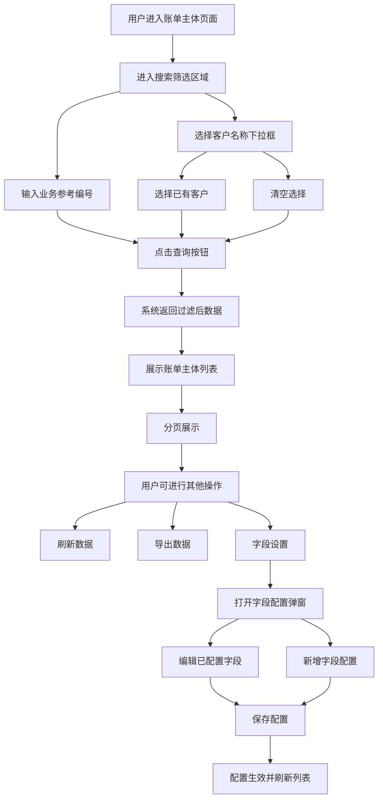

# 账单主体管理 PRD

---

## 一、需求背景

业财管理系统需要提供账单主体的管理功能，用于维护和查询账单主体信息。当前系统已有基础框架，但账单主体模块的查询条件及字段配置功能需要完善，以提升用户操作效率和灵活性。

**现状问题**：
- 客户名称查询条件为文本输入，无法快速选择已有客户
- 字段设置弹窗中包含冗余的"操作"列，提示文字与实际功能不符

---

## 二、需求目标

1. 将客户名称查询条件从文本输入改为下拉框选择，支持筛选已有客户数据
2. 优化字段设置弹窗，移除冗余操作列，统一功能定位为"可编辑历史字段"
3. 提升账单主体模块的用户操作体验和查询效率

---

## 三、需求核心业务流程图

---

## 四、需求功能清单

| 终端 | 模块 | 功能 | 描述 |
|------|------|------|------|
| 前端 | 账单主体 | 搜索筛选-业务参考编号 | 支持文本输入业务参考编号进行精确/模糊查询 |
| 前端 | 账单主体 | 搜索筛选-客户名称 | 改为下拉框选择，支持从已有客户列表筛选 |
| 前端 | 账单主体 | 查询按钮 | 根据筛选条件查询账单主体数据 |
| 前端 | 账单主体 | 重置按钮 | 清空所有筛选条件并重新查询 |
| 前端 | 账单主体 | 刷新数据按钮 | 重新加载当前筛选条件下的数据 |
| 前端 | 账单主体 | 导出按钮 | 导出当前筛选结果（待实现） |
| 前端 | 账单主体 | 字段设置按钮 | 打开自定义字段配置弹窗 |
| 前端 | 账单主体 | 账单主体列表 | 展示账单主体数据，支持多选、分页 |
| 前端 | 账单主体 | 自定义动态列 | 根据字段配置展示自定义列 |
| 前端 | 账单主体 | 字段配置弹窗 | 已配置字段展示与编辑、新增字段配置 |
| 前端 | 账单主体 | 保存字段配置 | 保存字段配置到本地存储 |

---

## 五、需求功能详述

---

#### 5.1 前端——账单主体——搜索筛选

**原型描述**：
搜索面板位于页面顶部，水平排列业务参考号输入框、客户名称下拉选择框、查询按钮、重置按钮。

**用户故事**：
> 作为一个财务人员，我想要通过客户名称下拉快速筛选账单主体，以便于快速定位目标客户的数据。

**前置条件**：
- 用户已登录系统并进入账单主体页面

**核心逻辑**：
- 业务参考编号：文本输入，支持清空
- 客户名称：下拉选择，支持清空、筛选过滤
- 点击查询后触发列表数据刷新

**边界条件与异常处理**：
- 边界条件：下拉框数据为空时显示"暂无数据"
- 异常处理：查询异常时显示错误提示

**验收标准 (Acceptance Criteria)**：
- 🎯 **成功场景**：选择客户名称后点击查询，列表正确显示该客户数据
- ✔️ **校验场景**：下拉框支持输入文字筛选
- ❌ **异常场景**：查询请求超时时显示加载失败提示

**测试用例**（遵循 MECE 原则）：
- 选择客户名称后点击查询，列表正确过滤
- 清空客户选择后点击查询，显示全部数据
- 下拉框输入文字可正确筛选匹配项
- 点击重置按钮，所有筛选条件清空

---

#### 5.2 前端——账单主体——账单主体列表

**原型描述**：
表格展示账单主体数据，包含复选框、序号、账单主体、业务参考编号、客户名称等固定列，以及根据字段配置动态生成的自定义列。

**用户故事**：
> 作为一个财务人员，我想要查看账单主体的完整列表信息，以便于进行数据核对和分析。

**前置条件**：
- 用户已登录系统并进入账单主体页面

**核心逻辑**：
- 表格数据与分页信息联动
- 支持复选框多选
- 自定义字段根据本地存储配置动态渲染

**边界条件与异常处理**：
- 边界条件：列表数据为空时显示空状态
- 异常处理：加载失败时显示错误提示并提供重试按钮

**验收标准 (Acceptance Criteria)**：
- 🎯 **成功场景**：页面加载后正确展示账单主体列表
- ✔️ **校验场景**：勾选复选框后正确高亮显示
- ❌ **异常场景**：数据加载失败时显示友好错误提示

**测试用例**：
- 列表正确展示账单主体数据
- 分页切换正确加载对应页数据
- 自定义字段根据配置正确显示
- 多选复选框功能正常

---

#### 5.3 前端——账单主体——字段设置弹窗

**原型描述**：
弹窗分为两个区域：已配置字段列表（表字段列、中文名称列）、新增字段表单（表字段输入框、中文名称输入框、添加按钮）。

**用户故事**：
> 作为一个管理员，我想要自定义账单主体列表的展示字段，以便于满足不同业务场景的数据展示需求。

**前置条件**：
- 用户点击字段设置按钮打开弹窗

**核心逻辑**：
- 已配置字段支持直接编辑表字段名称和中文名称
- 新增字段需填写完整的表字段和中文名称
- 保存后配置存储到 localStorage

**边界条件与异常处理**：
- 边界条件：新增字段字段名已存在时提示"该字段已存在"
- 边界条件：字段信息不完整时禁止添加/保存
- 异常处理：保存失败时显示错误提示

**验收标准 (Acceptance Criteria)**：
- 🎯 **成功场景**：编辑已配置字段后保存成功，列表正确显示新字段名
- ✔️ **校验场景**：新增字段时字段名或中文名称为空时禁止添加
- ❌ **异常场景**：保存失败时提示用户并保留已填写内容

**测试用例**：
- 弹窗打开后正确显示已配置字段
- 编辑字段后保存成功
- 新增字段字段名已存在时提示错误
- 新增字段信息不完整时添加按钮禁用
- 保存配置后列表正确刷新
- 提示文字正确显示"已配置字段（可编辑历史字段）"
