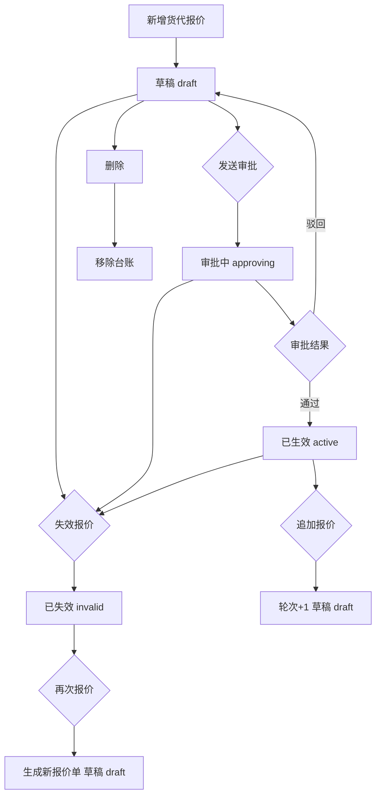
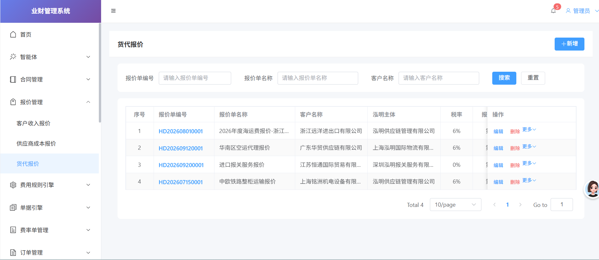
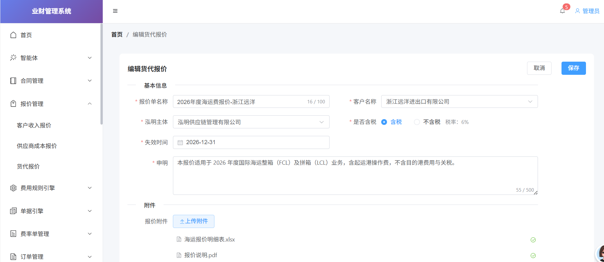
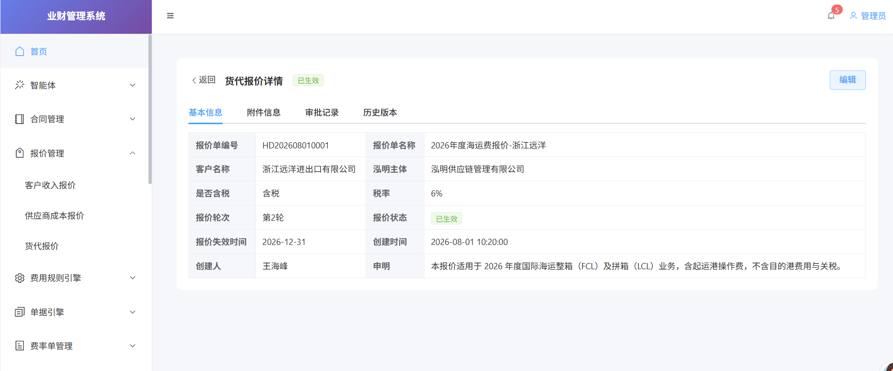

# 货代报价功能模块 PRD

## 文档信息

| 项目     | 内容                |
| -------- | ------------------- |
| 项目名称 | 业财一体化          |
| 迭代号   | V34.0               |
| 模块名称 | 报价管理 - 货代报价 |
| 编写日期 | 2026-10-21          |
| 编写人   | 产品                |

## 修改记录

| 版本号 | 修改日期   | 修改人 | 审核人 | 修改内容摘要 |
| ------ | ---------- | ------ | ------ | ------------ |
| V1.0   | 2026-10-21 |        |        | 初稿         |

---

## 1 需求背景

货代（国际货运代理）业务以向客户提供海运、空运、铁路、报关等运输服务并按服务项目计费为核心。当前货代业务对外报价存在以下痛点：

1. **报价分散、无统一台账**：各业务员以 Excel、邮件、微信等方式零散报价，客户、主体、税率、失效时间等关键要素无统一记录，导致同一客户多轮报价难以追溯、重复报价与过期报价混用。
2. **报价生命周期不可控**：报价从草拟、审批到生效、失效缺乏标准化流转，存在未审批即对外报价、已过期报价仍被引用的风险。
3. **多轮报价无版本沉淀**：对同一客户的多次调价、追加报价仅保留最终结果，历史报价内容、时间、操作人无法回溯，价格争议时缺乏依据。
4. **报价与后续收入/成本核算脱节**：报价中的含税状态、税率等要素未结构化，后续应收、应付核算环节需人工二次核对，易出错。

为此，在报价管理模块下新增「货代报价」子模块，实现货代报价的标准化录入、审批流转、状态管理、版本留存与附件归档，为后续业财一体化核算提供结构化报价数据基础。

## 2 需求目标及价值

### （一）调研信息和数据

- **业务对象**：国际货运代理业务（海运、空运、铁路、报关、运输等），报价单以「泓明主体 + 客户 + 服务内容」为维度。
- **报价状态**：草稿、审批中、已生效、已失效四态。
- **税率规则**：货代/物流现代服务业，含税报价适用税率 6%，不含税报价税率为 0%（税额另计）。
- **泓明主体**：泓明供应链管理有限公司、上海泓明国际物流有限公司、香港泓明物流有限公司、深圳泓明报关服务有限公司等。
- **审批链路**：提交审批 → 部门主管审批 → 总经理审批（按样例数据推断，审批层级待业务最终确认）。
- **编号规则**：报价单编号格式 `HD + 年月日(YYYYMMDD) + 4 位流水号`，如 `HD202608010001`。

### （二）需求预期目标

**本次产品迭代的目标是实现以下功能和效果：**

| 序号 | 模块               | 价值                                                                                       |
| ---- | ------------------ | ------------------------------------------------------------------------------------------ |
| 1    | 货代报价列表与查询 | 建立货代报价统一台账，支持按报价单编号、名称、客户名称模糊检索，减少报价查找成本           |
| 2    | 报价新增/编辑      | 结构化录入报价单要素（客户、主体、含税、税率、失效时间、申明），消除零散报价信息不完整问题 |
| 3    | 报价审批流转       | 报价发送审批后进入审批链路，通过后生效，规避未审批即对外报价的风险                         |
| 4    | 报价状态管理       | 支持失效、追加、再次报价等操作，保证报价生命周期可控、过期报价不误用                       |
| 5    | 历史版本留存       | 多轮报价逐轮留痕，支持价格争议时的历史回溯                                                 |
| 6    | 附件归档           | 报价明细表、说明文档等附件统一归档，作为报价依据留档                                       |

## 3 需求概述

### （一）用户角色

| 角色       | 身份范畴             | 主要权限                                                         |
| ---------- | -------------------- | ---------------------------------------------------------------- |
| 业务员     | 货代业务一线人员     | 新增、编辑、删除（草稿）、发送审批、追加报价、失效报价、再次报价 |
| 部门主管   | 审批链路第一级审批人 | 审批货代报价                                                     |
| 总经理     | 审批链路最终审批人   | 审批货代报价                                                     |
| 报价查阅人 | 财务、客服、管理层等 | 查看报价详情、附件、审批记录、历史版本                           |

### （二）总体流程

### （三）功能摘要

**本产品主要包含以下核心功能：**

| 序号 | 模块   | 功能         | 描述                                                                               |
| ---- | ------ | ------------ | ---------------------------------------------------------------------------------- |
| 1    | 列表页 | 报价台账展示 | 展示全部货代报价单，含编号、名称、客户、主体、税率、轮次、状态、失效时间、创建信息 |
| 2    | 列表页 | 模糊查询     | 按报价单编号、报价单名称、客户名称模糊检索，支持重置                               |
| 3    | 列表页 | 新增报价     | 跳转新增页，录入报价单基本信息与附件                                               |
| 4    | 列表页 | 编辑报价     | 跳转编辑页，修改报价单要素                                                         |
| 5    | 列表页 | 删除报价     | 二次确认后删除报价单                                                               |
| 6    | 列表页 | 发送审批     | 提交报价进入审批链路，状态由草稿转为审批中                                         |
| 7    | 列表页 | 追加报价     | 复制当前报价生成新轮次，轮次 +1，状态回草稿                                        |
| 8    | 列表页 | 失效报价     | 将报价标记为已失效                                                                 |
| 9    | 列表页 | 再次报价     | 基于历史报价复制生成新报价单（轮次重置为 1）                                       |
| 10   | 详情页 | 基本信息     | 展示报价单全部核心字段                                                             |
| 11   | 详情页 | 附件信息     | 展示报价附件名称、大小、上传人、上传时间                                           |
| 12   | 详情页 | 审批记录     | 时间线展示审批步骤、审批人、状态与意见                                             |
| 13   | 详情页 | 历史版本     | 倒序展示各轮次报价版本记录                                                         |

### （四）对其他系统的影响

| 序号 | 系统          | 影响                                                               | 方案                                                         |
| ---- | ------------- | ------------------------------------------------------------------ | ------------------------------------------------------------ |
| 1    | 审批工作流    | 报价发送审批后需接入审批引擎，按提交审批 → 部门主管 → 总经理流转 | 当前前端模拟审批记录，后续接入统一审批中心，审批层级待确认   |
| 2    | 客户管理      | 新增/编辑报价时客户名称依赖客户主数据                              | 当前使用静态客户目录，后续对接客户主数据接口                 |
| 3    | 组织/主体管理 | 泓明主体下拉依赖主体主数据                                         | 当前使用静态主体目录，后续对接组织架构接口                   |
| 4    | 附件存储      | 报价附件需上传、归档、下载                                         | 当前前端本地模拟，后续接入对象存储，单文件上限 20MB          |
| 5    | 报价版本历史  | 货代报价各轮次版本需在「报价版本历史」模块中汇总                   | 版本数据由货代报价新增/编辑/追加时同步沉淀                   |
| 6    | 客户报价 H5   | 生效报价需可对客户侧展示                                           | 当前报价状态为「已生效」的记录可作为对外报价来源，关联待确认 |
| 7    | 应收/应付核算 | 报价含税状态与税率需流转至收入/成本核算                            | 后续核算模块读取报价结构化数据，税率规则待确认               |

## 4 需求功能

### （一）货代报价

#### 1. 列表页

##### （1）查询字段

| 序号 | 字段       | 字段值   | 必填 | 说明                   |
| ---- | ---------- | -------- | ---- | ---------------------- |
| 1    | 报价单编号 | 文本输入 | 否   | 模糊匹配，回车触发搜索 |
| 2    | 报价单名称 | 文本输入 | 否   | 模糊匹配，回车触发搜索 |
| 3    | 客户名称   | 文本输入 | 否   | 模糊匹配，回车触发搜索 |

##### （2）列表字段

| 序号 | 字段         | 字段值   | 必填 | 说明                                                      |
| ---- | ------------ | -------- | ---- | --------------------------------------------------------- |
| 1    | 序号         | 数字     | —   | 按分页自动计算                                            |
| 2    | 报价单编号   | 文本     | 是   | 超链接，点击进入详情页                                    |
| 3    | 报价单名称   | 文本     | 是   | 超出省略并悬浮提示                                        |
| 4    | 客户名称     | 文本     | 是   | 超出省略并悬浮提示                                        |
| 5    | 泓明主体     | 文本     | 是   | 超出省略并悬浮提示                                        |
| 6    | 税率         | 文本     | 是   | 展示含税/不含税                                           |
| 7    | 报价轮次     | 数字     | 是   | 展示为`第{round}轮`                                     |
| 8    | 报价状态     | 枚举     | 是   | 草稿/审批中/审批驳回/审批通过/已失效，按状态渲染 tag 颜色 |
| 9    | 报价失效时间 | 日期     | 是   | 格式 YYYY-MM-DD                                           |
| 10   | 创建时间     | 日期时间 | 是   | 格式 YYYY-MM-DD HH:mm:ss                                  |
| 11   | 创建人       | 文本     | 是   | —                                                        |
| 12   | 操作         | 按钮组   | —   | 编辑、删除、更多（下拉）                                  |

##### （3）按钮字段

| 序号 | 字段          | 字段值   | 必填 | 说明                                         |
| ---- | ------------- | -------- | ---- | -------------------------------------------- |
| 1    | 新增          | 主按钮   | —   | 跳转新增页                                   |
| 2    | 搜索          | 主按钮   | —   | 触发查询并重置至第 1 页                      |
| 3    | 重置          | 次按钮   | —   | 清空查询条件并重置至第 1 页                  |
| 4    | 编辑          | 链接按钮 | —   | 跳转编辑页                                   |
| 5    | 删除          | 链接按钮 | —   | 二次确认后删除，删除成功提示                 |
| 6    | 更多-发送审批 | 下拉项   | —   | 调用审批模板为“货代”的审批流程，发起OA审批 |
| 7    | 更多-追加报价 | 下拉项   | —   | 版本+1                                       |
| 8    | 更多-失效报价 | 下拉项   | —   | 失效报价                                     |
| 9    | 更多-再次报价 | 下拉项   | —   | 版本+1                                       |

| 操作                                 | 状态     |
| ------------------------------------ | -------- |
| 查看，编辑，删除(初次草稿)，发送审批 | 草稿     |
| 查看                                 | 审批中   |
| 查看，编辑，发送审批                 | 审批驳回 |
| 查看，追加报价，失效报价             | 审批通过 |
| 查看，再次报价                       | 已失效   |

#### 2. 新增/编辑页

##### （1）字段

| 序号 | 字段       | 字段值   | 必填 | 说明                                                                                                                               |
| ---- | ---------- | -------- | ---- | ---------------------------------------------------------------------------------------------------------------------------------- |
| 1    | 报价单名称 | 文本输入 | 是   | 最长 100 字，显示字数统计                                                                                                          |
| 2    | 客户名称   | 下拉选择 | 是   | 可搜索，数据源为签约主体名称                                                                                                       |
| 3    | 泓明主体   | 下拉选择 | 是   | 可搜索，数据源为泓明主体                                                                                                           |
| 4    | 是否含税   | 单选     | 是   | 含税 / 不含税                                                                                                                      |
| 5    | 失效时间   | 日期选择 | 是   | 格式 YYYY-MM-DD                                                                                                                    |
| 6    | 申明       | 文本域   | 是   | 根据含税/不含税显示相关内容                                                                                                        |
| 7    | 报价附件   | 文件上传 | 否   | 支持常用文档格式，单文件不超过 20MB；可多选、可移除 上传后自动跳转WPS在线编辑页面，保存后 可再次点击文档跳转在线编辑页面 |

#### 3. 查看页

详情页以标签页（Tabs）组织，分为「基本信息」「附件信息」「审批记录」「历史版本」四个页签，顶部展示状态标签并提供「编辑」按钮。

##### （1）基本信息字段

| 序号 | 字段         | 字段值   | 必填 | 说明                    |
| ---- | ------------ | -------- | ---- | ----------------------- |
| 1    | 报价单编号   | 文本     | —   | 系统生成，只读          |
| 2    | 报价单名称   | 文本     | —   | 只读                    |
| 3    | 客户名称     | 文本     | —   | 只读                    |
| 4    | 泓明主体     | 文本     | —   | 只读                    |
| 5    | 是否含税     | 枚举     | —   | 含税 / 不含税           |
| 6    | 报价轮次     | 数字     | —   | 展示为`第{round}轮`   |
| 7    | 报价状态     | 枚举     | —   | tag 展示                |
| 8    | 报价失效时间 | 日期     | —   | YYYY-MM-DD              |
| 9    | 创建时间     | 日期时间 | —   | YYYY-MM-DD HH:mm:ss     |
| 10   | 创建人       | 文本     | —   | —                      |
| 11   | 申明         | 文本     | —   | 无值时展示`-`，跨两列 |

##### （2）附件信息字段

| 序号 | 字段     | 说明                                                          |
| ---- | -------- | ------------------------------------------------------------- |
| 1    | 附件名称 | 只读                                                          |
| 2    | 操作     | 下载 点击下载按钮后下载PDF格式，并加盖相关泓明主体的印章 |

##### （3）审批记录字段（和售前报价中的逻辑保持一致）

以时间线（Timeline）展示，每条记录包含：

| 序号 | 字段     | 说明 |
| ---- | -------- | ---- |
| 1    | 序号     |      |
| 2    | 报价轮次 |      |
| 3    | 审批状态 |      |
| 4    | 操作时间 |      |
| 5    | 审批意见 |      |
| 6    | 审批备注 |      |
| 7    | 操作人   |      |

##### （4）历史版本字段

倒序展示（最新在前），字段如下：

| 序号 | 字段     | 说明 |
| ---- | -------- | ---- |
| 1    | 序号     |      |
| 2    | 报价轮次 |      |
| 3    | 报价状态 |      |
| 4    | 创建时间 |      |
| 5    | 创建人   |      |

---

## 5 状态流转与业务规则（补充）

### （一）报价状态字典

| 名称     | 说明                       |
| -------- | -------------------------- |
| 草稿     | 新建/追加/再次报价后的状态 |
| 审批中   | 发送审批后等待审批         |
| 审批通过 | 审批通过后生效             |
| 审批驳回 | 审批驳回后生效             |
| 已失效   | 手动失效或过期后失效       |

### （二）操作可用性规则

| 操作     | 草稿 | 审批中 | 审批通过 | 审批驳回 | 已失效 |
| -------- | ---- | ------ | -------- | -------- | ------ |
| 编辑     | 可   | 可     | 可       |          | 可     |
| 删除     | 可   | 可     | 可       |          | 可     |
| 发送审批 | 可   | 禁用   | 禁用     |          | 可     |
| 追加报价 | 可   | 可     | 可       |          | 禁用   |
| 失效报价 | 可   | 可     | 可       |          | 禁用   |
| 再次报价 | 可   | 可     | 可       |          | 可     |
